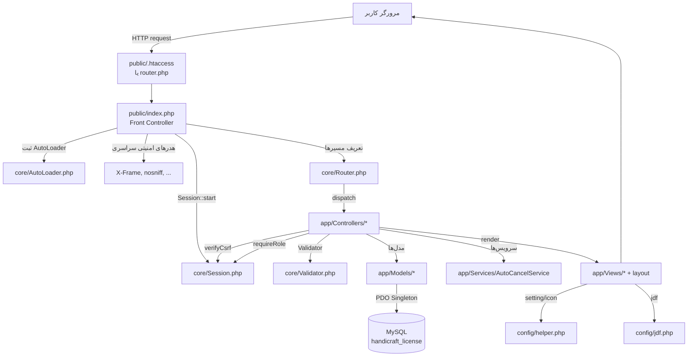
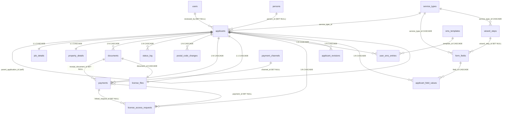
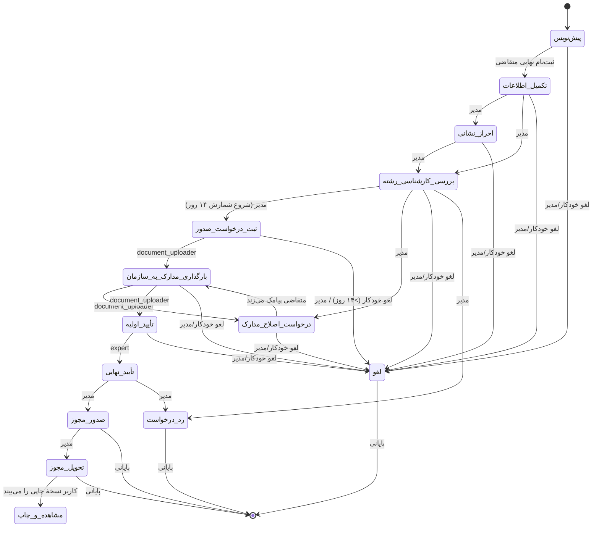
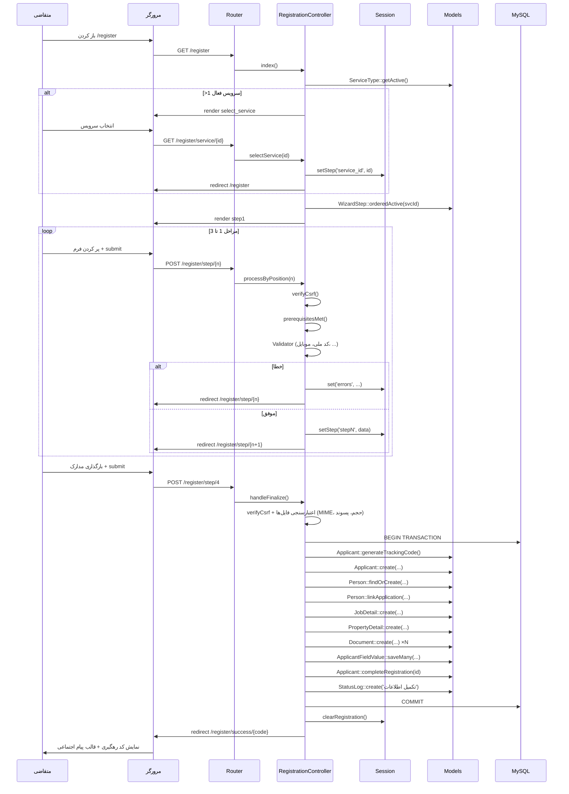

# بلوپرینت فنی پروژهٔ Mojavez 🗺️

> **نسخهٔ سند:** ۱.۰ — متناظر با کد پایه `0.1.0` (`APP_VERSION`) —
> **مسیر پروژه:** `/home/z/my-project/work/Mojavez/`
> **طراح و توسعه‌دهنده:** امین دروگر بزدی (`Derogaramin@`)
>
> این فایل یک **نقشهٔ فنیِ یکپارچه** از سامانه است: معماری، نقشهٔ کلاس‌ها،
> مدل داده‌ها، گردش کار، فرایندها و امنیت در یک نگاه. هر ادعای فنی با
> ارجاع به فایل/خط واقعی پشتیبانی می‌شود. کد پروژه دست‌نخورده باقی می‌ماند.

---

## ۱. نمای کلی پروژه (Executive Summary)

سامانهٔ **مجوز** (Mojavez) یک **سامانهٔ مدیریت ثبت‌نام و پیگیری صدور مجوز
صنایع دستی** است که با هدف بوروکراتیک‌زدایی از فرآیند دریافت مجوز برای
هنرمندان و صنعتگران ایرانی طراحی شده است. این سامانه با **PHP ۸ خالص**
(بدون فریم‌ورک و بدون کامپوزر) و معماری **MVC دست‌نویس** پیاده‌سازی شده
و تنها وابستگی سمت کلاینت آن Bootstrap 5 RTL و فونت وزیرمتن (محلی) است
(`config/config.php:41` — کلید `USE_CDN`).

**کاربران نهایی سامانه سه دسته‌اند:**

1. **متقاضیان مجوز** (اشخاص حقیقی و حقوقی) — ثبت‌نام چندمرحله‌ای،
   بارگذاری مدارک، دریافت کد رهگیری، پیگیری وضعیت، درخواست تغییر کد
   پستی، ثبت رسید پرداخت، دریافت تصویر مجوز با توکن ۷۲ ساعته، درخواست
   بازبینی پرونده، مشاهدهٔ سوابق چندمجوزی با احراز هویت شش‌عاملی.
2. **مدیران/کارشناسان سامانه** با سه نقش: `admin` (مدیر کل)، `expert`
   (کارشناس)، `document_uploader` (متصدی بارگذاری مدارک به سازمان) —
   هرکدام فقط وظایف نقش خود را می‌بیند (`config/workflow.php`).
3. **مالک/برند سامانه** — تنظیمات هویتی، شبکه‌های اجتماعی، قالب پیام
   اطلاع‌رسانی، محتوای صفحهٔ «دربارهٔ ما» و تصویر پروفایل از پنل مدیریت.

**فناوری:** PHP 8 + MySQL/MariaDB (PDO، Prepared Statements)، Bootstrap 5 RTL،
فونت‌های وزیرمتن و لاله‌زار، تقویم جلالی (`config/jdf.php`)، بدون فریم‌ورک،
بدون کامپوزر، بدون وابستگی خارجی.

**خلاصهٔ قابلیت‌ها (یک پاراگراف):** سامانه مجوز یک بستر یکپارچهٔ تحت وب است
که از ثبت‌نام چندمرحله‌ای متقاضی با ویزارد پویا (مراحل سفارشی قابل تنظیم
از پنل مدیریت)، اعتبارسنجی سمت سرور و کلاینت، آپلود امن مدارک با بررسی
MIME واقعی و نام تصادفی، تولید کد رهگیری یکتا، تایم‌لاین رویدادها، گردش
کار تأیید تغییر کد پستی، پنل مدیریت نقش‌محور با داشبورد آماری و هشدار
«در آستانهٔ لغو»، لغو خودکار درخواست‌های منقضی بدون نیاز به cron job،
اولویت‌بندی خودکار ثبت‌نام‌های طولانی، گردش پرداخت هزینهٔ ثبت‌نام با
کانال‌های پرداخت قابل مدیریت، تصویر مجوز صادرشده با قاعدهٔ «یک‌بار دریافت»
و لینک توکن‌دار ۷۲ ساعته، چرخهٔ بازبینی پرونده با نمای مقایسهٔ diff،
چندمجوزی و سلسله‌مراتب تمدید/ارتقا، مشاهدهٔ سوابق با احراز هویت شش‌عاملی،
پشتیبانی اشخاص حقوقی با اعتبارسنجی رقم کنترل شناسهٔ ملی، انواع خدمات
(صنایع دستی، مشاغل خانگی، گردشگری، هنری)، فرم‌ساز پویا، مدیریت رشته‌ها،
الگوهای پیامک با ارتقای خودکار وضعیت، گزارش‌های CSV/چاپی/گروه‌بندی‌شده،
تنظیمات از پنل، تم روز/شب، و امنیت چندلایه (CSRF، Rate-limit، Session
Fixation، Prepared Statements، MIME، Path Traversal) پشتیبانی می‌کند.

---

## ۲. ساختار معماری (Architecture)

### ۲.۱ الگوی معماری

الگوی به‌کاررفته **MVC دست‌نویس** است — بدون فریم‌ورک، بدون کامپوزر،
بدون هیچ وابستگی خارجی PHP. نقطهٔ ورود یگانه `public/index.php`
(Front Controller) است که تمامی درخواست‌ها از آن عبور می‌کنند
(`public/index.php:1-209`).



### ۲.۲ لایه‌ها و مسئولیت‌ها

| لایه | مسیر | مسئولیت |
|---|---|---|
| **core/** | `core/` | هستهٔ فنی: `Router` (مسیریابی URL تمیز با `{id}` named-capture)، `Database` (Singleton PDO با `ATTR_EMULATE_PREPARES=false`)، `Session` (CSRF + Rate-limit + داده‌های ویزارد)، `Validator` (اعتبارسنجی فارسی: کد ملی، شناسهٔ ملی حقوقی، کد پستی، موبایل)، `AutoLoader` (SPL autoload در ۴ مسیر)، `CsvExporter` (خروجی CSV با BOM فارسی)، `PdfGenerator` |
| **config/** | `config/` | `config.php` (ثابت‌های سامانه)، `helper.php` (توابع تاریخ شمسی، `setting()`، `social_links()`، `build_notify_message()`، دیکشنری `icon()` با ۵۰+ آیکون SVG)، `jdf.php` (تقویم جلالی)، `workflow.php` (قواعد انتقال وضعیت نقش‌ها)، `statuses.php` (**مرجع مرکزی وضعیت‌ها**: ترتیب یکطرفه، رنگ، قابلیت تنظیم دستی، مشمول لغو خودکار) |
| **app/Controllers/** | `app/Controllers/` | کنترلرهای HTTP (۱۸ کنترلر)؛ همگی از `Controller` پایه ارث می‌برند که `render/redirect/json/verifyCsrf/requireLogin/requireRole/isSuperAdmin` را فراهم می‌کند (`app/Controllers/Controller.php:1-146`) |
| **app/Models/** | `app/Models/` | لایهٔ داده؛ هر مدل یک جدول + کوئری‌های Prepared (۲۰ مدل). الگوی Repository-مانند: مدل‌ها فقط کوئری می‌دانند، نه منطق تجاری |
| **app/Services/** | `app/Services/` | منطق بین‌لایه‌ای: `AutoCancelService` (لغو خودکار + اولویت‌بندی زمان‌محور) |
| **app/Views/** | `app/Views/` | قالب‌ها: `layout.php` (عمومی)، `admin_layout.php` (پنل با سایدبار)، `layout_print.php` (چاپ A4) + نماهای صفحات در زیرپوشه‌های `admin/`، `registration/`، `tracking/` |
| **database/** | `database/schema.sql` | اسکیمای یکپارچهٔ پایگاه داده در یک فایل واحد با حفظ ترتیب وابستگی‌ها |
| **uploads/** | `uploads/` | فایل‌های کاربران — **خارج از document root** با `.htaccess` محافظ (لایهٔ دوم امنیتی) |
| **public/** | `public/` | **document root یگانه** — شامل `index.php`، `router.php` (توسعه)، `assets/` (Bootstrap محلی، فونت‌ها، JS تم) |

### ۲.۳ جریان درخواست (Request Lifecycle)

یک درخواست از URL تا پاسخ این مسیر را طی می‌کند:

1. **ورودی وب‌سرور:** Apache با `public/.htaccess` (یا `router.php` در
   توسعه) تمام مسیرهای غیرفیزیکی را به `public/index.php` بازنویسی می‌کند.
2. **بوت‌استرپ:** `index.php` ثابت‌های `config.php` را بارگذاری،
   `helper.php` و `jdf.php` را require، `AutoLoader::register()` را فعال،
   و هدرهای امنیتی سراسری (`X-Frame-Options`, `X-Content-Type-Options`,
   `Referrer-Policy`, `Permissions-Policy`) را اعمال می‌کند
   (`public/index.php:43-48`).
3. **مدیریت خطای سراسری:** `set_exception_handler` و `set_error_handler`
   هیچ خطای کنترل‌نشده‌ای را به‌صورت raw نشان نمی‌دهند؛ در حالت
   `APP_DEBUG=true` جزئیات برای توسعه‌دهنده و در غیر این صورت صفحهٔ عمومی
   ۵۰۰ نمایش داده می‌شود (`public/index.php:16-41`).
4. **نشست:** `Session::start()` کوکی نشست را با `HttpOnly`، `SameSite=Lax`،
   `Secure` (روی HTTPS) و نام اختصاصی `MOJAVEZSESSID` تنظیم می‌کند
   (`core/Session.php:12-25`).
5. **مسیریابی:** نمونهٔ `Router` ساخته می‌شود و ~۹۰ مسیر به آن افزوده
   می‌شود (`public/index.php:52-209`). سپس `Router::dispatch()` متد HTTP
   و URI را با الگوهای `preg_match` تطبیق می‌دهد؛ پارامترهای `{id}` به‌صورت
   named capture استخراج و به اکشن کنترلر پاس داده می‌شوند
   (`core/Router.php:31-44, 49-89`).
6. **کنترلر:** بررسی `requireLogin/requireRole` → در POST فراخوانی
   `verifyCsrf()` → اعتبارسنجی با `Validator` → تعامل با مدل‌ها → ذخیرهٔ
   پیام‌ها در Session (الگوی PRG — Post/Redirect/Get) → رندر نما یا redirect.
7. **رندر نما:** `Controller::render()` نما را داخل بافر خروجی (`ob_start`)
   رندر کرده و سپس درون layout مربوطه (`layout` یا `admin_layout` یا
   `layout_print`) قرار می‌دهد (`app/Controllers/Controller.php:13-35`).
8. **خروج:** پاسخ HTML به مرورگر ارسال می‌شود. در مسیرهای JSON از
   `Controller::json()` با هدر `Content-Type: application/json; charset=utf-8`
   استفاده می‌شود.

### ۲.۴ الگوهای طراحی به‌کار رفته

| الگو | محل استفاده |
|---|---|
| **Singleton** | `Database::getInstance()` — یک اتصال PDO در کل چرخهٔ درخواست (`core/Database.php:26-32`) |
| **Front Controller** | `public/index.php` — نقطهٔ ورود یگانه |
| **Post/Redirect/Get** | همهٔ فرم‌ها؛ خطاها و داده‌های بازگشتی در `Session` ذخیره می‌شوند (جلوگیری از ارسال مجدد فرم با Refresh) |
| **Autoloader (SPL)** | `core/AutoLoader.php` — جستجوی کلاس در `core/`, `Controllers/`, `Models/`, `Services/` |
| **Repository-مانند** | مدل‌ها فقط کوئری می‌دانند، نه منطق تجاری |
| **Service Layer** | `AutoCancelService` — منطق زمان‌محور لغو/اولویت جدا از کنترلرها |
| **Workflow/State Machine** | `config/workflow.php` + ترتیب یکطرفهٔ وضعیت‌ها در `AdminController::changeStatus` |
| **Token-based access** | `LicenseController::viewByToken` — لینک‌های ۷۲ ساعته با توکن ۶۴ نویسه‌ای `random_bytes` |

### ۲.۵ مکانیزم‌های زمان‌محور (بدون cron)

سرورهای اشتراکی معمولاً cron در اختیار نمی‌گذارند؛ بنابراین دو وظیفهٔ
زمان‌محور به‌صورت **رویداد-محور (Event-driven)** در نقاط ورودی پربازدید
اجرا می‌شوند:

```php
AutoCancelService::cancelExpired();    // لغو درخواست‌های > AUTO_CANCEL_DAYS روز
AutoCancelService::updatePriorities(); // پرچم ⭐ برای ثبت‌نام‌های > PRIORITY_DAYS روز
```

نقاط فراخوانی: داشبورد مدیر (`AdminController.php:118-119`)، فهرست
درخواست‌ها (`AdminController.php:191-192`)، صفحهٔ پیگیری کاربر
(`TrackingController.php:40-41, 96-97`) و `GET /check-cancel` (اجرای
دستی/خارجی). هر دو عملیات **Idempotent** هستند: شرط `current_status != 'لغو'`
و `priority = 0` از تکرار بیهوده جلوگیری می‌کند (`app/Services/AutoCancelService.php:17-55`).

---

## ۳. نقشهٔ کلاس‌ها و ماژول‌ها (Class & Module Map)

### ۳.۱ کنترلرها (`app/Controllers/`)

همهٔ کنترلرها از کلاس پایهٔ `Controller` ارث می‌برند که متدهای مشترک
`render/redirect/json/isPost/input/allInputs/verifyCsrf/requireLogin/requireRole/isSuperAdmin`
را فراهم می‌کند.

| فایل | متد | مسئولیت | نقش |
|---|---|---|---|
| `Controller.php` | `render(view, data, layout)` | رندر نما با قالب | — (پایه) |
| `Controller.php` | `redirect(url)` | هدایت HTTP با `Location` | — |
| `Controller.php` | `json(data, code)` | پاسخ JSON با UTF-8 | — |
| `Controller.php` | `verifyCsrf()` | اعتبارسنجی توکن CSRF یا کد ۴۱۹ | — |
| `Controller.php` | `requireLogin()` | هدایت به لاگین اگر نشست نباشد | — |
| `Controller.php` | `requireRole(roles, redirect)` | بررسی نقش یا کد ۴۰۳ | — |
| `HomeController.php` | `index()` | صفحهٔ اصلی | عمومی |
| `HomeController.php` | `guide()` | راهنمای جامع | عمومی |
| `HomeController.php` | `about()` | دربارهٔ ما (محتوا از `settings`) | عمومی |
| `RegistrationController.php` | `index()` | ورودی ویزارد + انتخاب نوع خدمت | عمومی |
| `RegistrationController.php` | `selectService(id)` | ثبت انتخاب سرویس در سشن | عمومی |
| `RegistrationController.php` | `stepByPosition(n)` | نمایش مرحلهٔ n (موقعیت‌محور) | عمومی |
| `RegistrationController.php` | `processByPosition(n)` | پردازش POST مرحلهٔ n | عمومی |
| `RegistrationController.php` | `step1/2/3/4()` | نام‌های مستعار قدیمی | عمومی |
| `RegistrationController.php` | `processStep1/2/3/4()` | نام‌های مستعار قدیمی | عمومی |
| `RegistrationController.php` | `success(trackingCode)` | نمایش کد رهگیری + قالب پیام | عمومی |
| `TrackingController.php` | `search()` | فرم جستجوی کد رهگیری | عمومی |
| `TrackingController.php` | `find()` | پردازش جستجو (Rate-limit ۱۰/دقیقه) | عمومی |
| `TrackingController.php` | `status(trackingCode)` | نمایش وضعیت + تایم‌لاین | عمومی |
| `TrackingController.php` | `changePostalCode()` | ثبت درخواست تغییر کد پستی | عمومی |
| `TrackingController.php` | `submitPayment()` | ثبت رسید پرداخت هزینه | عمومی |
| `TrackingController.php` | `submitSms()` | ثبت پیامک دریافتی سازمان | عمومی |
| `TrackingController.php` | `printView(trackingCode)` | نسخهٔ چاپی A4 | عمومی |
| `AdminController.php` | `loginForm()` / `login()` / `logout()` | احراز هویت پنل | عمومی/نشست |
| `AdminController.php` | `dashboard()` | داشبورد آماری | admin/expert/uploader |
| `AdminController.php` | `applications()` | فهرست کامل با فیلتر/صفحه‌بندی | admin |
| `AdminController.php` | `viewApplication(id)` | جزئیات پرونده | ورود |
| `AdminController.php` | `changeStatus()` | تغییر وضعیت یکطرفه | admin/expert/uploader |
| `AdminController.php` | `registerForm()` / `registerProcess()` | ثبت دستی متقاضی | admin |
| `AdminController.php` | `editApplication(id)` / `updateApplication()` | ویرایش پرونده | admin |
| `AdminController.php` | `addDocument()` | افزودن مدرک به پرونده | ورود |
| `AdminController.php` | `requestPayment()` | فعال‌سازی درخواست پرداخت | admin |
| `AdminController.php` | `updateLicenseState()` | وضعیت مجوز + والد | admin |
| `AdminController.php` | `postalRequests()` | فهرست درخواست‌های کد پستی | ورود |
| `AdminController.php` | `approvePostalRequest()` / `rejectPostalRequest()` | تأیید/رد کد پستی | admin/expert |
| `AdminController.php` | `myTasks()` | وظایف نقش جاری | admin/expert/uploader |
| `UserController.php` | `index/createForm/store/editForm/update/delete` | CRUD کاربران | admin |
| `LicenseController.php` | `firstAccess()` | دریافت اول خودکار + توکن ۷۲ ساعت | عمومی |
| `LicenseController.php` | `requestAccess()` | ثبت درخواست دریافت مجدد | عمومی |
| `LicenseController.php` | `submitReissuePayment()` | رسید پرداخت دریافت مجدد | عمومی |
| `LicenseController.php` | `viewByToken(token)` | سرو تصویر مجوز با توکن | عمومی (توکن‌دار) |
| `LicenseController.php` | `upload()` | بارگذاری تصویر مجوز | admin |
| `LicenseController.php` | `requests()` / `reviewRequest()` | بررسی درخواست‌های دسترسی | admin |
| `RevisionController.php` | `form(trackingCode)` / `submit()` | چرخهٔ بازبینی متقاضی | عمومی |
| `RevisionController.php` | `index()` / `detail(id)` / `approve(id)` / `reject(id)` | مدیریت بازبینی‌ها | admin |
| `PaymentController.php` | `index()` | فهرست پرداخت‌ها + آمار | admin |
| `PaymentController.php` | `review()` | تأیید/رد رسید | admin |
| `PaymentController.php` | `csv()` | خروجی CSV پرداخت‌ها | admin |
| `PaymentController.php` | `saveChannel()` / `deleteChannel()` | CRUD کانال‌ها | admin |
| `SmsController.php` | `index()` / `saveTemplate()` / `deleteTemplate()` | CRUD الگوهای پیامک | admin |
| `SmsController.php` | `reviewEntry()` | تأیید/رد پیامک متقاضی → ارتقا | admin/expert |
| `RecordsController.php` | `form()` / `verify()` | احراز هویت شش‌عاملی سوابق | عمومی |
| `ReportController.php` | `csvReport()` / `pdfReport()` | خروجی CSV/چاپی | admin |
| `ReportController.php` | `byProvince/byCity/byVillage/byLicense/byDate()` | گزارش‌های گروهی | admin |
| `ReportController.php` | `generalReport()` / `singleApplicantReport(code)` | گزارش کلی/تک‌متقاضی | admin |
| `ReportController.php` | `groupedReportForm()` / `groupedReportResult()` | فرم و نتیجهٔ گروهی | admin |
| `DocumentController.php` | `view()` | نمایش مدرک با POST+CSRF | ورود |
| `DocumentController.php` | `serve(id)` / `thumb(id)` | سرو مستقیم/بندانگشتی | ورود |
| `FormFieldController.php` | `index/editForm/save/toggle/delete/move` | فرم‌ساز پویا | admin |
| `WizardStepController.php` | `index/save/toggle/delete/move` | CRUD مراحل ویزارد | admin |
| `ServiceTypeController.php` | `index/save/delete` | CRUD انواع خدمات | admin |
| `LicenseTitleController.php` | `index/save/delete/toggle` | CRUD رشته‌های مجوز | admin |
| `SettingController.php` | `index/save/uploadImage` | تنظیمات سامانه | admin |

### ۳.۲ مدل‌ها (`app/Models/`)

| فایل | مسئولیت اصلی | متدهای کلیدی |
|---|---|---|
| `Applicant.php` | هستهٔ پرونده‌ها | `create(data)`, `completeRegistration(id)`, `findByTrackingCode(code)`, `findById(id)`, `updateStatus(id, status)`, `getAll(filters, limit, offset)`, `countAll(filters)`, `updatePostalCode(id, pc)`, `findExpiredApplications(days)`, `generateTrackingCode()` (static) |
| `Person.php` | اشخاص (چندمجوزی — فاز ۷) | `findByNationalCode(nc)`, `findOrCreate(data)`, `linkApplication(aid, pid)`, `applications(personId)`, `mobileBelongsToOtherPerson(mob, nc)`, `syncFromApplicant(aid)`, `updateLicenseState(aid, state, validUntil)`, `logIdentityCheck(nc, success)`, `recentFailedChecks(nc, min)` |
| `JobDetail.php` | اطلاعات شغلی ۱:۱ | `create(data)`, `findByApplicantId(id)` |
| `PropertyDetail.php` | اطلاعات ملک ۱:۱ | `create(data)`, `findByApplicantId(id)` |
| `Document.php` | مدارک ۱:N | `create(data)`, `findByApplicantId(id)`, `findById(id)` |
| `StatusLog.php` | تایم‌لاین رویدادها | `create(data)`, `findByApplicantId(id)`, `getStatusDate(id, name)` |
| `PostalCodeChange.php` | درخواست‌های تغییر کد پستی | `create(data)`, `findPendingByApplicantId(id)`, `getAllWithApplicant(filter)`, `countPending()`, `review(id, status, revId, reason)` |
| `User.php` | مدیران پنل | `findByUsername(u)`, `getAll()`, `create(data)`, `update(id, data)`, `delete(id)`, `countByRole(role)`, `verifyPassword(pw, hash)` |
| `FormField.php` | فرم‌ساز پویا | `activeByStep(step)`, `activeByStepId(stepId, svcId)`, `allGrouped()`, `findById(id)`, `create(data)`, `update(id, data)`, `setActive(id, bool)`, `delete(id)`, `move(id, dir)`, `systemActiveMap()`, `parseRules(json)` (static), `parseOptions(text)` (static) |
| `WizardStep.php` | مراحل ویزارد | `orderedActive(svcId)`, `getAll()`, `findById(id)`, `findByViewKey(key)`, `positionOf(stepId)`, `create/update/setActive/delete/move` |
| `ApplicantFieldValue.php` | مقادیر فیلدهای پویا | `saveMany(applicantId, values)`, `findByApplicantId(id)`, `activeCustomFields()` |
| `LicenseTitle.php` | رشته‌های مجوز | `groupedActive()`, `getAll()`, `getCategories()`, `findById(id)`, `create/update/delete` |
| `ServiceType.php` | انواع خدمات | `getActive()`, `getAll()`, `findById(id)`, `create/update/delete` |
| `Setting.php` | تنظیمات کلید/مقدار | `all()` (کش), `get(key, default)`, `set(key, val)`, `setMany(pairs)`, `editableKeys()` (static) |
| `Payment.php` | پرداخت‌ها | `create(data)`, `findLatestByApplicant(id, purpose)`, `hasApproved(id, purpose)`, `getAllWithFilters(filters, l, o)`, `stats()`, `sumByChannel()`, `review(id, status, revId, reason)` |
| `PaymentChannel.php` | کانال‌های پرداخت | `getActive()`, `getAll()`, `findById(id)`, `create/update/delete` |
| `SmsTemplate.php` | الگوهای پیامک | `getActive()`, `getAll()`, `findById(id)`, `create/update/delete` |
| `UserSmsEntry.php` | پیامک‌های ثبت‌شده | `create(data)`, `getAllWithApplicant(filter)`, `findByApplicantId(id)`, `findPendingByApplicant(id)`, `review(id, status, revId, reason, applied)`, `countRecentByApplicant(id, hours)` |
| `LicenseFile.php` | تصویر مجوز صادرشده | `findByApplicantId(id)`, `upsert(aid, docId)`, `incrementDownload(id)` |
| `LicenseAccessRequest.php` | درخواست‌های دسترسی به مجوز | `findById(id)`, `findByToken(token)`, `findValidToken(aid)`, `create(aid, isFirst, requiresPayment, amount)`, `review(id, decision, revId, amount, reason)`, `grantAfterPayment(reqId)`, `attachPayment(reqId, payId)`, `expireStale()` (static) |
| `ApplicantRevision.php` | بازبینی‌های پرونده | `create(aid, payload, note)`, `findById(id)`, `findPendingByApplicant(aid)`, `countByApplicantSince(aid, days)`, `getAllWithApplicant(filter)`, `review(id, status, revId, reason)`, `pendingBadge()` (static) |

### ۳.۳ سرویس‌ها و هسته (`app/Services/`, `core/`)

| فایل | مسئولیت | متدهای کلیدی |
|---|---|---|
| `app/Services/AutoCancelService.php` | لغو خودکار + اولویت‌بندی زمان‌محور | `cancelExpired()` (static, idempotent), `updatePriorities()` (static, idempotent) |
| `core/Router.php` | مسیریابی URL تمیز | `get(path, handler)`, `post(path, handler)`, `dispatch(method, uri)` با ۴۰۴ فارسی |
| `core/Database.php` | Singleton PDO | `getInstance()`, `getConnection()` |
| `core/Session.php` | نشست + CSRF + Rate-limit + ویزارد | `start()`, `regenerate()` (ضد Session Fixation), `csrfToken()`, `csrfField()`, `checkCsrf(token)` (hash_equals), `hit(key)`, `isLimited(key, max, window)`, `retryAfter()`, `resetRate()`, `getStep/setStep/clearRegistration` |
| `core/Validator.php` | اعتبارسنجی فارسی | `required/minLength/maxLength/persianAlpha/nationalCode/legalNationalId/postalCode/mobile/unsignedInt/enum/unique/hasErrors/getErrors/firstError` + `isValidNationalCode(code)` و `isValidLegalNationalId(id)` (static — الگوریتم رقم کنترل) |
| `core/AutoLoader.php` | SPL autoload | `register()`, `loadClass(class)` |
| `core/CsvExporter.php` | خروجی CSV با BOM فارسی | `export(filename, headers, rows)` |
| `core/PdfGenerator.php` | تولید PDF (HTML بهینه برای چاپ) | — |

---

## ۴. مدل داده‌ای و روابط (Data Model & Relationships)

پایگاه داده: `handicraft_license` — کدگذاری `utf8mb4_unicode_ci`، موتور
`InnoDB` (تراکنش + FK). تنها یک فایل اسکیمای یکپارچه در `database/schema.sql`
(۸۵۹ خط) وجود دارد.

### ۴.۱ جداول

| # | جدول | شرح مختصر | محل تعریف |
|---|---|---|---|
| 1 | `users` | مدیران پنل (admin/expert/document_uploader) | schema.sql |
| 2 | `applicants` | هستهٔ پرونده‌ها + وضعیت + اولویت + پرداخت + نوع متقاضی | schema.sql |
| 3 | `job_details` | اطلاعات شغلی (۱:۱) | schema.sql |
| 4 | `property_details` | اطلاعات ملک (۱:۱) + آدرس | schema.sql |
| 5 | `documents` | مدارک (۱:N) | schema.sql |
| 6 | `status_log` | تایم‌لاین رویدادها | schema.sql |
| 7 | `postal_code_changes` | درخواست‌های تغییر کد پستی + گردش تأیید | schema.sql |
| 8 | `settings` | تنظیمات کلید/مقدار | schema.sql |
| 9 | `form_fields` | تعریف فیلدهای فرم ثبت‌نام | schema.sql |
| 10 | `applicant_field_values` | مقادیر فیلدهای پویا هر متقاضی | schema.sql |
| 11 | `license_titles` | رشته‌های مجوز (~۹۰ رشته در ۱۲ دسته) | schema.sql |
| 12 | `payment_channels` | کانال‌های پرداخت | schema.sql |
| 13 | `payments` | پرداخت‌های متقاضیان | schema.sql |
| 14 | `license_files` | تصویر مجوز صادرشده (۱:۱) | schema.sql |
| 15 | `license_access_requests` | درخواست‌های دسترسی به تصویر مجوز | schema.sql |
| 16 | `sms_templates` | الگوهای پیامک | schema.sql |
| 17 | `user_sms_entries` | پیامک‌های ثبت‌شده توسط متقاضی | schema.sql |
| 18 | `applicant_revisions` | بازبینی‌های پرونده (payload JSON) | schema.sql |
| 19 | `persons` | اشخاص (لنگر هویت = کد ملی) | schema.sql |
| 20 | `identity_checks` | لاگ احراز هویت (ضد Brute-force) | schema.sql |
| 21 | `wizard_steps` | مراحل ویزارد (سیستمی + سفارشی) | schema.sql |
| 22 | `service_types` | انواع خدمات (صنایع دستی، مشاغل خانگی، گردشگری، هنری) | schema.sql |

### ۴.۲ روابط کلیدی خارجی (FK)

همهٔ روابط فرزند با `ON DELETE CASCADE` (مگر مواردی که `SET NULL` برای
ممیزی است). لیست کامل:

```
job_details.applicant_id            → applicants.id          (ON DELETE CASCADE)
property_details.applicant_id       → applicants.id          (ON DELETE CASCADE)
documents.applicant_id              → applicants.id          (ON DELETE CASCADE)
status_log.applicant_id             → applicants.id          (ON DELETE CASCADE)
postal_code_changes.applicant_id    → applicants.id          (ON DELETE CASCADE)
postal_code_changes.reviewed_by     → users.id               (ON DELETE SET NULL)
applicant_field_values.applicant_id → applicants.id          (ON DELETE CASCADE)
applicant_field_values.field_id     → form_fields.id         (ON DELETE CASCADE)
payments.applicant_id               → applicants.id          (ON DELETE CASCADE)
payments.payment_channel_id         → payment_channels.id    (ON DELETE SET NULL)
payments.receipt_document_id        → documents.id           (ON DELETE SET NULL)
payments.reviewed_by                → users.id               (ON DELETE SET NULL)
payments.linked_request_id          → license_access_requests.id  (ON DELETE SET NULL)
license_files.applicant_id          → applicants.id          (ON DELETE CASCADE)
license_files.document_id           → documents.id           (ON DELETE CASCADE)
license_access_requests.applicant_id→ applicants.id          (ON DELETE CASCADE)
license_access_requests.payment_id  → payments.id            (ON DELETE SET NULL)
license_access_requests.reviewed_by → users.id               (ON DELETE SET NULL)
user_sms_entries.applicant_id       → applicants.id          (ON DELETE CASCADE)
user_sms_entries.sms_template_id    → sms_templates.id       (ON DELETE CASCADE)
user_sms_entries.reviewed_by        → users.id               (ON DELETE SET NULL)
applicant_revisions.applicant_id    → applicants.id          (ON DELETE CASCADE)
applicant_revisions.reviewed_by     → users.id               (ON DELETE SET NULL)
applicants.person_id                → persons.id             (ON DELETE SET NULL)
applicants.parent_application_id    → applicants.id          (ON DELETE SET NULL)
form_fields.wizard_step_id          → wizard_steps.id        (ON DELETE SET NULL)
form_fields.service_type_id         → service_types.id       (ON DELETE CASCADE)
wizard_steps.service_type_id        → service_types.id       (ON DELETE CASCADE)
applicants.service_type_id          → service_types.id       (ON DELETE SET NULL)
```

### ۴.۳ انواع روابط

| نوع | نمونه |
|---|---|
| **۱:۱** | `applicants ↔ job_details`، `applicants ↔ property_details`، `applicants ↔ license_files` (همگی با `UNIQUE(applicant_id)`) |
| **۱:N** | `applicants → documents`، `applicants → status_log`، `applicants → postal_code_changes`، `applicants → payments`، `applicants → applicant_revisions`، `applicants → user_sms_entries`، `applicants → applicant_field_values`، `persons → applicants` (یک شخص، چند پرونده) |
| **N:M** | مستقیم نیست؛ رابطهٔ `applicants ↔ form_fields` از طریق `applicant_field_values` به‌صورت **junction table** پیاده‌سازی شده است (هر جفت `(applicant_id, field_id)` یکتا با `UNIQUE KEY uniq_applicant_field`) |
| **Self-reference** | `applicants.parent_application_id → applicants.id` — زنجیرهٔ تمدید/ارتقا (یک پرونده می‌تواند «فرزند» پروندهٔ قبلیِ همان شخص باشد) |

### ۴.۴ ایندکس‌های مهم و دلیل ایجادشان

| ایندکس | جدول | دلیل |
|---|---|---|
| `idx_tracking_code` | applicants | جستجوی کد رهگیری در صفحهٔ پیگیری (پراستفاده‌ترین کوئری) |
| `idx_national_code` | applicants | احراز هویت سوابق، گزارش‌گیری |
| `idx_status` | applicants | فیلتر فهرست بر اساس وضعیت، آمار داشبورد |
| `idx_priority` | applicants | مرتب‌سازی فهرست با اولویت ⭐ |
| `idx_mobile` | applicants | جستجو با موبایل، یکتایی در سطح persons |
| `idx_completed_priority` | applicants | **ترکیبی** — مرتب‌سازی فهرست‌ها به‌صورت `(priority DESC, registration_completed_at DESC)` در یک کوئری |
| `idx_postal_status` | postal_code_changes | فیلتر سریع «در انتظار» در صفحهٔ بررسی مدیر |
| `idx_status_log_created` | status_log | محاسبهٔ لغو خودکار (`created_at < NOW() - INTERVAL 14 DAY`) |
| `idx_pay_status/purpose/applicant` | payments | فیلتر صفحهٔ درآمد |
| `idx_lar_status/applicant` | license_access_requests | یافتن توکن معتبر و درخواست‌های در انتظار |
| `idx_sms_status/applicant` | user_sms_entries | فیلتر پیامک‌های در انتظار |
| `idx_rev_status/applicant` | applicant_revisions | فهرست بازبینی‌های در انتظار |
| `idx_person_mobile` | persons | جستجوی شخص با موبایل |
| `idx_nc_time` | identity_checks | قفل تصاعدی: `recentFailedChecks(nc, 10min) >= 5` |
| `idx_step_active` | form_fields | `(step, is_active, sort_order)` — رندر سریع فیلدهای هر مرحله |
| `idx_applicant_type` | applicants | تفکیک حقیقی/حقوقی (فاز ۱۰) |
| `idx_license_state` | applicants | فیلتر «جاری/صادر شده/باطل/منقضی» (فاز ۷) |
| `idx_parent_app` | applicants | پیمایش سلسله‌مراتب تمدید |
| `idx_active_sort` | license_titles | رندر groupedActive بر اساس دسته و ترتیب |

### ۴.۵ نمودار ER (Mermaid)



---

## ۵. رویدادها و گردش کار (Events & Workflow)

### ۵.۱ وضعیت‌های ممکن پرونده (۱۴ وضعیت)

مرجع مرکزی: `config/statuses.php` — هر وضعیت دارای `order` (ترتیب یکطرفه)،
`color` (کلاس Bootstrap)، `manual` (قابلیت تنظیم دستی) و `pre_issue`
(مشمول لغو خودکار) است.

| # | وضعیت | order | رنگ | دستی | مشمول لغو |
|---|---|---|---|---|---|
| ۱ | پیش‌نویس | 1 | secondary | ✔ | ✔ |
| ۲ | تکمیل اطلاعات | 2 | info | ✔ | ✔ |
| ۳ | احراز نشانی | 3 | primary | ✔ | ✔ |
| ۴ | بررسی کارشناسی رشته | 4 | primary | ✔ | ✔ |
| ۵ | ثبت درخواست صدور | 5 | primary | ✔ | ✔ |
| ۶ | بارگذاری مدارک به سازمان | 6 | warning | ✔ | ✔ |
| ۷ | درخواست اصلاح مدارک | 7 | warning | ✔ | ✔ |
| ۸ | تأیید اولیه | 8 | success | ✔ | ✔ |
| ۹ | تأیید نهایی | 9 | success | ✔ | ✔ |
| ۱۰ | صدور مجوز | 10 | success | ✔ | ✘ (پایانی) |
| ۱۱ | تحویل مجوز | 11 | success | ✔ | ✘ (پایانی) |
| ۱۲ | مشاهده و چاپ | 12 | dark | ✘ (خودکار) | ✘ (پایانی) |
| ۱۳ | رد درخواست | 98 | danger | ✔ | ✘ (پایانی) |
| ۱۴ | لغو | 99 | danger | ✔ | ✘ (پایانی) |

وضعیت‌های **پایانی** (بسته‌شده): `صدور مجوز`، `تحویل مجوز`، `رد درخواست`،
`لغو` (`config/statuses.php:33`).

### ۵.۲ نمودار گذار وضعیت‌ها (State Machine)



> **قاعدهٔ یک‌طرفه:** بازگشت به وضعیتی با `order` کوچک‌تر ممنوع است، مگر
> پرش به «لغو» یا «رد درخواست» (`AdminController.php:343-356`). پرونده‌های
> پایانی دیگر قابل تغییر نیستند.

### ۵.۳ رویدادهای قابل Trigger و نقش هندلر

| رویداد | کنترلر/سرویس هندل‌کننده | اثر روی پرونده |
|---|---|---|
| **ثبت‌نام متقاضی** | `RegistrationController::handleFinalize` | ایجاد `applicants` + `job_details` + `property_details` + `documents` + `person` + فیلدهای پویا + لاگ «تکمیل اطلاعات» در تراکنش اتمی |
| **بارگذاری مدرک** | `RegistrationController::handleFinalize` و `AdminController::addDocument` | افزودن رکورد `documents` + لاگ «افزودن مدرک توسط مدیر» |
| **درخواست تغییر کد پستی** | `TrackingController::changePostalCode` | ثبت در `postal_code_changes` با status=در انتظار + لاگ «درخواست تغییر کد پستی» |
| **درخواست بازبینی (Revision)** | `RevisionController::submit` | ثبت `applicant_revisions` با payload JSON + لاگ «ثبت درخواست بازبینی» |
| **ثبت پیامک دریافتی** | `TrackingController::submitSms` | ثبت در `user_sms_entries` با status=در انتظار + لاگ «ثبت پیامک توسط متقاضی» |
| **پرداخت هزینهٔ ثبت‌نام** | `TrackingController::submitPayment` | ایجاد `documents` (رسید) + `payments` با status=در انتظار بررسی + لاگ «ثبت رسید پرداخت» |
| **پرداخت هزینهٔ دریافت مجدد مجوز** | `LicenseController::submitReissuePayment` | ایجاد `payments` با purpose=دریافت مجدد + `attachPayment` به درخواست + لاگ |
| **صدور مجوز** | `AdminController::changeStatus` (انتقال به «صدور مجوز») + `LicenseController::upload` (بارگذاری تصویر) | تغییر `current_status` + ایجاد `license_files` + لاگ «بارگذاری تصویر مجوز» |
| **دریافت اول تصویر مجوز** | `LicenseController::firstAccess` | ایجاد `license_access_requests` با status=تأیید شده + توکن ۷۲ ساعته + `incrementDownload` + لاگ «دریافت تصویر مجوز» |
| **لغو خودکار** | `AutoCancelService::cancelExpired` | تغییر `current_status` به «لغو» برای پرونده‌های > ۱۴ روز + لاگ «لغو خودکار» |
| **اولویت‌بندی** | `AutoCancelService::updatePriorities` | تنظیم `priority=1` برای ثبت‌نام‌های > ۱۲ روز (بدون لاگ) |
| **تأیید مدیر روی پیامک** | `SmsController::reviewEntry` | ارتقای `current_status` به `target_status` الگو (با رعایت مسیر یکطرفه) + لاگ «ارتقای وضعیت بر اساس پیامک» |
| **تأیید بازبینی توسط مدیر** | `RevisionController::approve` | اعمال payload JSON روی پرونده (اطلاعات هویتی/شغلی/ملک + فیلدهای پویا + مدارک جدید) در تراکنش اتمی + `syncFromApplicant` روی شخص + لاگ «تأیید بازبینی پرونده» |
| **مشاهدهٔ نسخهٔ چاپی** | `TrackingController::printView` | لاگ «مشاهده و چاپ پرونده» (رویداد خودکار، نه وضعیت دستی) |
| **تأیید/رد درخواست کد پستی** | `AdminController::approvePostalRequest/rejectPostalRequest` | اعمال کد جدید روی `applicants.postal_code` (فقط در تأیید) + به‌روزرسانی `postal_code_changes.status` + لاگ |
| **تغییر وضعیت دستی مدیر** | `AdminController::changeStatus` | به‌روزرسانی `current_status` با رعایت workflow نقش + لاگ با نام اقدام‌کننده (ممیزی) |

---

## ۶. فرایند ثبت‌نام متقاضی (Registration Process)

### ۶.۱ مراحل ویزارد

ویزارد پویا است: مراحل از جدول `wizard_steps` خوانده می‌شوند
(`RegistrationController.php:36-39` → `WizardStep::orderedActive`).
مراحل سیستمی پیش‌فرض چهار مرحله‌اند و مرحلهٔ سفارشی «اطلاعات پشتیبان»
برای سرویس مشاغل خانگی پشتیبان اضافه شده است (`database/schema.sql:827-837`).

| مرحله | عنوان | فیلدها | اعتبارسنجی کلیدی |
|---|---|---|---|
| **۱. اطلاعات هویتی** (`step1`) | نام، نام خانوادگی، کد ملی، کد پستی، موبایل، تاریخ تولد شمسی، نام پدر، وضعیت تأهل، تعداد فرزندان، وضعیت جسمانی، توضیحات معلولیت (شرطی)، دهک درآمدی، پرونده قضایی، وام فعال، اقساط معوقه + فیلدهای حقوقی (نام شرکت، شناسهٔ ملی، شماره ثبت، نوع شخصیت) | کد ملی (الگوریتم رقم کنترل)، شناسهٔ ملی حقوقی ۱۱ رقمی، کد پستی ۱۰ رقمی، موبایل `^09\d{9}$`، حروف فارسی، یکتایی موبایل در سطح persons، تبدیل تاریخ شمسی→میلادی |
| **۲. اطلاعات شغلی** (`step2`) | عنوان مجوز (select از `license_titles` یا «سایر» + ورود دستی)، سابقه (ماه)، نحوهٔ آموزش (در خانه/استاد شاگردی/کارگاهی) + فیلدهای پویا | الزامی، enum، عدد صحیح غیرمنفی، maxlength |
| **۳. اطلاعات ملک** (`step3`) | وضعیت مالکیت، استان، شهرستان، شهر، بخش (اختیاری)، دهستان (اختیاری)، روستا (اختیاری)، شناسهٔ قبض برق، خیابان، کوچه، پلاک + فیلدهای پویا | enum، maxlength، الزامی بر اساس نوع |
| **۴. بارگذاری مدارک** (`step4`) | کارت ملی (رو و پشت)، شناسنامه، مدرک مالکیت (متناسب با وضعیت)، گواهی فنی‌وحرفه‌ای (اختیاری)، مدرک تحصیلی (اختیاری)، تصاویر محصول (چندتایی)، ۳ فایل جانبی + فیلدهای پویای فایلی | پسوند `jpg/jpeg/png/pdf`، حجم ≤ ۲MB، **MIME واقعی با `finfo`**، نام تصادفی ۳۲ بایتی |

**محرک شروع:** `RegistrationController::index` اگر بیش از یک سرویس فعال
باشد، صفحهٔ انتخاب خدمت نمایش می‌دهد (`select_service.php`)؛ اگر تنها یک
سرویس فعال باشد، خودکار انتخاب می‌شود (`RegistrationController.php:77-98`).

**پیش‌نیاز هر مرحله:** `prerequisitesMet` بررسی می‌کند که دادهٔ مراحل
قبلی در سشن موجود باشد؛ در غیر این صورت به ابتدا هدایت می‌شود
(`RegistrationController.php:54-63`).

### ۶.۲ تولید کد رهگیری

کد رهگیری در پایان مرحلهٔ ۴ و داخل تراکنش اتمی تولید می‌شود:

```php
// app/Models/Applicant.php:230-246
public static function generateTrackingCode(): string {
    $prefix = 'HG';
    $unique = strtoupper(substr(bin2hex(random_bytes(4)), 0, 8));
    $code = $prefix . '-' . $unique;  // مثال: HG-1A2B3C4D
    // بررسی یکتایی در جدول و تلاش مجدد در صورت تکرار
}
```

قالب: `HG-XXXXXXXX` — ۸ نویسهٔ hex تصادفی با پیشوند `HG` (احتمالاً
«Handicraft»).

### ۶.۳ پیام موفقیت و قالب اجتماعی

پس از موفقیت، کاربر به `/register/success/{trackingCode}` هدایت می‌شود
(`RegistrationController.php:726`). صفحهٔ موفقیت شامل:

- **کد رهگیری** با دکمه‌های «کپی» و «چاپ».
- **پیام آمادهٔ اجتماعی** که با `build_notify_message($fullName, $trackingCode)`
  از قالب تنظیمات (`success_message_template`) ساخته می‌شود
  (`config/helper.php:117-125`):

```
باسلام
{name} هستم .
در سامانه مدارک رو بارگذاری کردم و کد رهگیری {code} را اخذ نمودم .
با تشکر {name}
```

- دکمه‌های ارسال مستقیم به ایتا/روبیکا/بله با آیدی `Derogaramin@`
  (از `social_links()`).

قالب پیام از پنل مدیریت قابل ویرایش است و **باید** شامل جای‌نمای
`{code}` یا `{کد رهگیری}` باشد (`SettingController.php:62-66`).

### ۶.۴ نمودار Sequence ثبت‌نام



---

## ۷. فرایند پیگیری پرونده (Tracking Process)

### ۷.۱ ورود کد رهگیری

- صفحهٔ `GET /tracking` (`TrackingController::search`) ابتدا لغو خودکار را
  اجرا می‌کند تا لغوهای جدید فوراً دیده شوند.
- `POST /tracking/search` (`TrackingController::find`) با **محدودسازی نرخ:
  ۱۰ جستجو در دقیقه** (مبتنی بر سشن — `Session::isLimited('tracking_search', 10, 60)`).
- در صورت یافتن، هدایت به `GET /tracking/status/{code}`.

### ۷.۲ نمایش تایم‌لاین (StatusLog)

صفحهٔ `status` اطلاعات زیر را بارگذاری می‌کند (`TrackingController.php:87-167`):

- اطلاعات متقاضی + وضعیت فعلی
- `status_log` (تایم‌لاین رویدادها با تاریخ شمسی)
- `postal_code_changes` (سوابق و درخواست در انتظار)
- آخرین پرداخت هزینهٔ ثبت‌نام
- درخواست بازبینی در انتظار (فاز ۲)
- پیامک‌های ثبت‌شده + الگوهای فعال (فاز ۵)
- تصویر مجوز (اگر وضعیت به «صدور/تحویل» رسیده باشد — فاز ۶)

### ۷.۳ درخواست تغییر کد پستی

گردش کار **تأیید/رد** (نه اعمال فوری):

```mermaid
sequenceDiagram
    participant U as متقاضی
    participant T as TrackingController
    participant PC as PostalCodeChange
    participant SL as StatusLog
    participant A as AdminController
    participant M as Admin

    U->>T: POST /tracking/change-postal-code (CSRF)
    T->>T: verifyCsrf + Rate-limit (3/ساعت)
    T->>T: Validator (postalCode 10 رقم)
    T->>PC: findPendingByApplicantId (جلوگیری از درخواست موازی)
    T->>PC: create(status='در انتظار')
    T->>SL: create('درخواست تغییر کد پستی')
    T->>U: redirect status (پیام موفقیت)

    M->>A: GET /admin/postal-requests
    A->>M: render فهرست درخواست‌های در انتظار
    alt تأیید
        M->>A: POST /admin/postal-requests/approve (CSRF)
        A->>A: requireRole(['admin','expert'])
        A->>PC: BEGIN; review(status='تأیید شده')
        A->>A: Applicant::updatePostalCode(newCode)
        A->>SL: create('تأیید تغییر کد پستی')
        A->>PC: COMMIT
    else رد
        M->>A: POST /admin/postal-requests/reject (CSRF + reason)
        A->>PC: review(status='رد شده', reason)
        A->>SL: create('رد درخواست تغییر کد پستی')
    end
```

### ۷.۴ مشاهدهٔ نسخهٔ چاپی

`GET /tracking/print/{code}` (`TrackingController::printView`):

- رندر ویوی `print.php` با `layout_print.php` (چیدمان A4 با `@page` و
  `page-break` هوشمند).
- هر بار مشاهده، رویداد «مشاهده و چاپ پرونده» در `status_log` ثبت می‌شود
  (`TrackingController.php:470-474`). این رویداد در آمار وضعیت‌ها نمی‌آید.

### ۷.۵ درخواست بازبینی (Revision)

- `GET /tracking/revision/{code}` (`RevisionController::form`): فرم کامل
  مراحل ۱ تا ۳ **پیش‌پرشده** با دادهٔ فعلی + امکان افزودن مدرک جدید.
- `POST /tracking/revision/submit` (`RevisionController::submit`):
  - **محدودیت:** ۲ درخواست در ۷ روز و نبود درخواست در انتظار
    (`RevisionController.php:496-505`).
  - ذخیرهٔ payload JSON در `applicant_revisions` با status=در انتظار +
    مدارک جدید با doc_type='revision_doc'.
- مدیر در `GET /admin/revisions` فهرست را می‌بیند و در
  `GET /admin/revisions/view/{id}` یک **نمای مقایسه** (diff ساده: کدام
  فیلد تغییر کرده) مشاهده می‌کند.
- `POST /admin/revisions/approve/{id}`: اعمال تغییرات در تراکنش اتمی
  (UPDATE applicants/job_details/property_details + saveMany فیلدهای پویا +
  فعال‌سازی مدارک revision_doc + `Person::syncFromApplicant`).
- `POST /admin/revisions/reject/{id}`: حذف فیزیکی فایل‌های موقت + رکورد
  documents با doc_type='revision_doc' + ثبت دلیل.

### ۷.۶ مشاهدهٔ تصویر مجوز با توکن ۷۲ ساعته

قاعدهٔ **«یک‌بار دریافت»** (فاز ۶):

| مرحله | کنترلر | اثر |
|---|---|---|
| **دریافت اول** (خودکار، رایگان) | `LicenseController::firstAccess` | اگر `download_count=0` و وضعیت پرونده = «صدور مجوز/تحویل مجوز»: ایجاد `license_access_requests` با status=تأیید شده + توکن ۶۴ نویسه‌ای + expires_at=NOW+72h + `incrementDownload` + هدایت به `/license/view/{token}` |
| **دریافت مجدد** | `LicenseController::requestAccess` | ایجاد درخواست با status=در انتظار (Rate-limit: ۲ در هفته) |
| **تصمیم مدیر** | `LicenseController::reviewRequest` | سه حالت: `approve_free` (تأیید رایگان → توکن ۷۲ ساعت)، `approve_paid` (تأیید مشروط به پرداخت با مبلغ تعیین‌شده)، `reject` (رد با دلیل) |
| **پرداخت** | `LicenseController::submitReissuePayment` | ثبت رسید پرداخت → `attachPayment` به درخواست |
| **تأیید رسید توسط مدیر** | `PaymentController::review` | اگر پرداختِ «دریافت مجدد» تأیید شد → `grantAfterPayment` خودکار توکن ۷۲ ساعت صادر می‌کند (`PaymentController.php:91-95`) |
| **سرو فایل با توکن** | `LicenseController::viewByToken` | بررسی توکن + status=تأیید شده + عدم انقضا + Path Traversal check + MIME whitelist + `Content-Disposition: inline` |

```mermaid
stateDiagram-v2
    [*] --> بدون_دسترسی
    بدون_دسترسی --> توکن_فعال_۷۲ساعت: firstAccess (خودکار، رایگان)
    توکن_فعال_۷۲ساعت --> منقضی_شده: گذشت ۷۲ ساعت
    منقضی_شده --> در_انتظار: requestAccess
    در_انتظار --> تأیید_رایگان: approve_free → توکن ۷۲ ساعت
    در_انتظار --> در_انتظار_پرداخت: approve_paid + مبلغ
    در_انتظار --> رد_شده: reject
    در_انتظار_پرداخت --> در_انتظار_تأیید_رسید: submitReissuePayment
    در_انتظار_تأیید_رسید --> توکن_فعال_۷۲ساعت: PaymentController::review (approve) → grantAfterPayment
    در_انتظار_تأیید_رسید --> رد_شده: PaymentController::review (reject)
    توکن_فعال_۷۲ساعت --> [*]
    رد_شده --> [*]
```

---

## ۸. گردش کار مدیر (Admin Workflows)

### ۸.۱ احراز هویت چندنقشی

سه نقش در `users.role` تعریف شده‌اند (`UserController.php:13-15`):
- **`admin`** — مدیر کل؛ دسترسی کامل به همهٔ منابع.
- **`expert`** — کارشناس؛ بررسی پرونده‌های در وضعیت‌های `from` (طبق
  `config/workflow.php`) و تغییر به وضعیت‌های `to`.
- **`document_uploader`** — متصدی بارگذاری مدارک به سازمان؛ بررسی
  پرونده‌های در «ثبت درخواست صدور» و «بارگذاری مدارک به سازمان» و تغییر
  به «تأیید اولیه» یا «صدور مجوز».

قواعد انتقال در `config/workflow.php:1-19` متمرکز است؛ نقش `admin` مجاز به
هر انتقالی است. `AdminController::changeStatus` این قواعد را اعمال می‌کند
(`AdminController.php:296-370`).

### ۸.۲ داشبورد آماری

`GET /admin/dashboard` (`AdminController.php:115-183`) شامل:

- کارت‌های آماری: کل درخواست‌ها، لغوشده‌ها، در انتظار رسیدگی.
- آمار تفکیکی هر وضعیت (۱۳ وضعیت — به‌جز «مشاهده و چاپ» که رویداد خودکار
  است).
- تعداد درخواست‌های تغییر کد پستی در انتظار.
- تعداد پرونده‌های اولویت‌دار (⭐).
- آمار مالی (`Payment::stats`).
- **هشدار «در آستانهٔ لغو»:** پرونده‌هایی که بیش از `AUTO_CANCEL_DAYS - 4`
  روز از «ثبت درخواست صدور» آن‌ها گذشته ولی هنوز لغو نشده‌اند
  (`AdminController.php:147-160`) — یک هشدار ۴ روزه پیش از لغو خودکار.
- ۸ رویداد اخیر سامانه با لینک مستقیم به پرونده.

### ۸.۳ مدیریت پرونده‌ها

`GET /admin/applications` (فقط `admin`) با فیلترهای:
`tracking_code`, `name`, `national_code`, `mobile`, `province`, `city`,
`village`, `license_title`, `status` + صفحه‌بندی ۱۵ رکوردی
(`AdminController.php:186-226`).

`GET /admin/my-tasks` (`AdminController.php:1002-1039`): برای نقش‌های غیر
admin، فقط پرونده‌های در وضعیت‌های `from` نقش جاری نمایش داده می‌شود.

**تغییر وضعیت یک‌طرفه:** `AdminController::changeStatus` این قواعد را اعمال
می‌کند:
1. نقش مجاز است؟ (admin همیشه؛ بقیه طبق workflow)
2. وضعیت جدید در فهرست `manual=true` است؟
3. ترتیب جدید بزرگ‌تر از فعلی (مگر لغو/رد)
4. پرونده پایانی نیست (`AdminController.php:343-356`)

### ۸.۴ فرم‌ساز پویا (CRUD فیلدها و مراحل)

| منبع | کنترلر | امکانات |
|---|---|---|
| **مراحل ویزارد** | `WizardStepController` | ایجاد مرحلهٔ سفارشی (عنوان، آیکون، شرح، ترتیب، فعال)؛ غیرفعال/حذف (مرحلهٔ سیستمی حذف‌شدنی نیست)؛ جابجایی بالا/پایین |
| **فیلدهای فرم** | `FormFieldController` | ایجاد فیلد دلخواه (text/number/textarea/select/radio/checkbox/date_jalali/file) در هر مرحله؛ ویرایش، حذف (سیستمی غیرقابل حذف)، فعال/غیرفعال، جابجایی؛ قواعد اعتبارسنجی (`min/max/maxlength/pattern`) و گزینه‌ها (هر خط یکی) |
| **رشته‌های مجوز** | `LicenseTitleController` | افزودن/ویرایش/حذف/غیرفعال‌سازی رشته‌ها (در صورت استفاده → غیرفعال) |
| **انواع خدمات** | `ServiceTypeController` | CRUD خدمات (صنایع دستی، مشاغل خانگی مستقل/پشتیبان، گردشگری، هنری) |

### ۸.۵ سایر مدیریت‌ها

| منبع | کنترلر | خلاصه |
|---|---|---|
| **کاربران** | `UserController` | CRUD کاربران با نقش‌ها؛ جلوگیری از حذف admin اصلی (id=1) و آخرین مدیر نقش‌دار |
| **تنظیمات** | `SettingController` | ویرایش ۱۱ کلید مجاز (`editableKeys`) + بارگذاری تصویر مدیر |
| **کانال‌های پرداخت** | `PaymentController::saveChannel/deleteChannel` | CRUD کانال‌ها |
| **الگوهای پیامک** | `SmsController::saveTemplate/deleteTemplate` | CRUD الگوها با `target_status` و `requires_code` |
| **بررسی پیامک‌ها** | `SmsController::reviewEntry` | تأیید → ارتقای وضعیت پرونده به `target_status` (با رعایت مسیر یکطرفه)؛ رد با دلیل |
| **بررسی بازبینی** | `RevisionController::approve/reject` | اعمال payload یا حذف مدارک موقت |
| **تصویر مجوز** | `LicenseController::upload/requests/reviewRequest` | بارگذاری تصویر مجوز روی پرونده؛ بررسی درخواست‌های دسترسی |
| **پرداخت‌ها** | `PaymentController::index/review` | فهرست با فیلتر + آمار مالی + تأیید/رد رسید |
| **کد پستی** | `AdminController::postalRequests/approvePostalRequest/rejectPostalRequest` | فهرست درخواست‌ها + تأیید/رد |

### ۸.۶ گزارش‌ها

`ReportController` (همه فقط برای `admin`):

| متد | خروجی | توضیح |
|---|---|---|
| `csvReport` | CSV (با BOM فارسی) | ۲۵ ستون ثابت + ستون‌های پویای فیلدهای سفارشی؛ تاریخ‌ها به شمسی |
| `pdfReport` | HTML بهینه برای چاپ | بدون کتابخانهٔ خارجی؛ کاربر با Print-to-PDF مرورگر فایل PDF می‌سازد |
| `byProvince/byCity/byVillage/byLicense/byDate` | جدول آماری | `GROUP BY` با `COUNT(*)` مرتب نزولی |
| `generalReport` | صفحهٔ فیلتر + لینک خروجی | ورودی فیلترها برای CSV/چاپی |
| `singleApplicantReport(trackingCode)` | چاپی تک‌متقاضی | بدون ثبت رویداد مشاهدهٔ کاربر |
| `groupedReportForm/groupedReportResult` | گزارش گروهی | فیلتر بر اساس استان/شهر/روستا/رشته/تاریخ/وضعیت — کلیدها از فهرست سفید کد |

---

## ۹. امنیت (Security)

### ۹.۱ لایه‌های امنیتی

| لایه | پیاده‌سازی | فایل مرجع |
|---|---|---|
| **CSRF** | توکن ۶۴ نویسه‌ای هر نشست؛ `hash_equals` در `checkCsrf`؛ فیلد `_csrf` در همهٔ ۱۴+ فرم POST و درخواست‌های AJAX نمایش مدرک؛ پاسخ نامعتبر: کد ۴۱۹ | `core/Session.php:69-97`, `app/Controllers/Controller.php:89-108` |
| **Rate Limiting** | `Session::hit/isLimited/retryAfter/resetRate`؛ ورود: ۵/۵دقیقه؛ جستجو: ۱۰/دقیقه؛ تغییر کد پستی: ۳/ساعت؛ پیامک: ۳/۲۴ساعت (مبتنی بر دیتابیس در `UserSmsEntry::countRecentByApplicant`)؛ بازبینی: ۲/۷روز؛ درخواست مجوز: ۲/هفته | `core/Session.php:99-147`, کنترلرهای مربوطه |
| **Session** | کوکی `HttpOnly` + `SameSite=Lax` + `Secure` (HTTPS) + نام اختصاصی `MOJAVEZSESSID`؛ `regenerate()` پس از ورود موفق (ضد Session Fixation)؛ `destroy()` کامل در خروج | `core/Session.php:12-67` |
| **Prepared Statements** | PDO با `ATTR_EMULATE_PREPARES=false`؛ تمام کوئری‌ها پارامتری؛ ستون‌های ORDER BY/GROUP BY پویا از فهرست سفید کد | `core/Database.php:14-23`, `app/Models/*` |
| **MIME آپلود** | `finfo(FILEINFO_MIME_TYPE)` روی محتوای واقعی فایل؛ لیست سفید `image/jpeg, image/png, application/pdf`؛ پسوند جعلی رد می‌شود | `RegistrationController.php:557-573`, `AdminController.php:776-782`, `LicenseController.php:170-175` |
| **نام تصادفی** | `bin2hex(random_bytes(16))` یا `(32)` برای فایل‌ها و توکن‌ها؛ غیرقابل حدس | کنترلرهای آپلود |
| **خارج از document root** | پوشهٔ `uploads/` بیرون از `public/` + `.htaccess` با `Require all denied` + `php_flag engine off` | `uploads/.htaccess` |
| **Path Traversal** | `realpath()` + بررسی `str_starts_with($filePath, $base)` + حذف `..` و `\0` | `DocumentController.php:84-91`, `LicenseController.php:255-260` |
| **XSS** | `htmlspecialchars(..., ENT_QUOTES, 'UTF-8')` در همهٔ نماها؛ `basename()` روی نام فایل آپلودی | `app/Views/*` |
| **هدرهای امنیتی** | `X-Content-Type-Options: nosniff`, `X-Frame-Options: SAMEORIGIN`, `Referrer-Policy: strict-origin-when-cross-origin`, `Permissions-Policy: geolocation=(), microphone=(), camera=()` | `public/index.php:43-48` |
| **محدودسازی دسترسی مدیر** | `chmod 0640` روی فایل‌های ذخیره‌شده؛ فایل‌های پیکربندی بیرون از public | `AdminController.php:794` و کنترلرهای آپلود |
| **مدیریت خطا** | `set_exception_handler` سراسری؛ در حالت تولید `APP_DEBUG=false` — هیچ جزئیاتی (مسیر فایل، stack trace) به کاربر نشان داده نمی‌شود؛ خطاها در `error_log` | `public/index.php:16-41` |
| **تراکنش اتمی** | `beginTransaction/commit/rollBack` در عملیات چندجدولی (ثبت‌نام، تأیید کد پستی، تأیید بازبینی) | `RegistrationController.php:580-733`, `AdminController.php:948-968`, `RevisionController.php:378-449` |

### ۹.۲ توکن‌ها و نقش‌ها

| نوع توکن | طول/قالب | عمر | کاربرد |
|---|---|---|---|
| **CSRF** | ۶۴ نویسه hex | عمر نشست (۲۴ ساعت) | محافظت همهٔ فرم‌های POST |
| **کد رهگیری** | `HG-XXXXXXXX` (۸ hex) | دائمی | دسترسی به پرونده متقاضی |
| **توکن تصویر مجوز** | ۶۴ نویسه hex | **۷۲ ساعت** (`LicenseAccessRequest::TOKEN_HOURS`) | لینک دسترسی به تصویر مجوز |

### ۹.۳ محافظت Session Fixation

`Session::regenerate()` (یعنی `session_regenerate_id(true)`) بلافاصله پس از
ورود موفق صدا زده می‌شود تا شناسهٔ نشست بازنویسی شود
(`AdminController.php:88-89`). این کار حملهٔ Session Fixation (که مهاجم
شناسهٔ نشست را پیش از ورود تعیین می‌کند) را خنثی می‌کند. همچنین پس از
خروج، نشست نابود شده و نشست تازه‌ای شروع می‌شود
(`AdminController.php:103-110`).

### ۹.۴ احراز هویت چندعاملی سوابق (فاز ۸)

`RecordsController::verify` یک احراز هویت **شش‌عاملی** بدون حساب کاربری
انجام می‌دهد:

| عامل | ستون |
|---|---|
| کد ملی | `national_code` |
| نام | `first_name` |
| نام خانوادگی | `last_name` |
| نام پدر | `father_name` |
| موبایل | `mobile` |
| تاریخ تولد | `birth_date` (تبدیل شمسی→میلادی) |

محافظت‌ها (`RecordsController.php:46-118`):
- Rate-limit نشست: ۳ تلاش در ۱۰ دقیقه.
- **قفل تصاعدی مبتنی بر دیتابیس**: ۵ شکست در ۱۰ دقیقه → ۳۰ دقیقه قفل
  (`Person::recentFailedChecks(nc, 10) >= 5`).
- پاسخ خطای **یکسان** (نشت وجود/عدم وجود رکورد ندارد).
- لاگ امنیتی `identity_checks` با IP و موفقیت/شکست.

---

## ۱۰. نقشهٔ مسیرها (Routes)

تمامی مسیرها در `public/index.php:52-209` ثبت شده‌اند. جدول کامل:

### ۱۰.۱ مسیرهای عمومی

| متد | مسیر | کنترلر | متد | نقش |
|---|---|---|---|---|
| GET | `/` | `HomeController` | `index` | عمومی |
| GET | `/guide` | `HomeController` | `guide` | عمومی |
| GET | `/about` | `HomeController` | `about` | عمومی |
| GET | `/register` | `RegistrationController` | `index` | عمومی |
| GET | `/register/service/{id}` | `RegistrationController` | `selectService` | عمومی |
| GET | `/register/step/{n}` | `RegistrationController` | `stepByPosition` | عمومی |
| POST | `/register/step/{n}` | `RegistrationController` | `processByPosition` | عمومی |
| GET/POST | `/register/step1..4` | `RegistrationController` | `step1..4` / `processStep1..4` | عمومی (نام مستعار) |
| GET | `/register/success/{trackingCode}` | `RegistrationController` | `success` | عمومی |
| GET | `/tracking` | `TrackingController` | `search` | عمومی |
| POST | `/tracking/search` | `TrackingController` | `find` | عمومی |
| GET | `/tracking/status/{trackingCode}` | `TrackingController` | `status` | عمومی |
| POST | `/tracking/change-postal-code` | `TrackingController` | `changePostalCode` | عمومی |
| GET | `/tracking/print/{trackingCode}` | `TrackingController` | `printView` | عمومی |
| POST | `/tracking/payments/submit` | `TrackingController` | `submitPayment` | عمومی |
| POST | `/tracking/sms/submit` | `TrackingController` | `submitSms` | عمومی |
| POST | `/tracking/license/first-access` | `LicenseController` | `firstAccess` | عمومی |
| POST | `/tracking/license/request-access` | `LicenseController` | `requestAccess` | عمومی |
| POST | `/tracking/license/pay` | `LicenseController` | `submitReissuePayment` | عمومی |
| GET | `/license/view/{token}` | `LicenseController` | `viewByToken` | عمومی (توکن‌دار) |
| GET | `/my-records` | `RecordsController` | `form` | عمومی |
| POST | `/my-records/verify` | `RecordsController` | `verify` | عمومی |
| GET | `/tracking/revision/{trackingCode}` | `RevisionController` | `form` | عمومی |
| POST | `/tracking/revision/submit` | `RevisionController` | `submit` | عمومی |
| GET | `/check-cancel` | (closure) | `AutoCancelService::cancelExpired + updatePriorities` | عمومی |

### ۱۰.۲ مسیرهای پنل مدیریت — احراز هویت و داشبورد

| متد | مسیر | کنترلر | متد | نقش |
|---|---|---|---|---|
| GET | `/admin/login` | `AdminController` | `loginForm` | عمومی |
| POST | `/admin/login` | `AdminController` | `login` | عمومی |
| GET | `/admin/logout` | `AdminController` | `logout` | نشست |
| GET | `/admin/dashboard` | `AdminController` | `dashboard` | admin/expert/uploader |
| GET | `/admin/my-tasks` | `AdminController` | `myTasks` | admin/expert/uploader |

### ۱۰.۳ مسیرهای پنل مدیریت — پرونده‌ها

| متد | مسیر | کنترلر | متد | نقش |
|---|---|---|---|---|
| GET | `/admin/applications` | `AdminController` | `applications` | admin |
| GET | `/admin/view/{id}` | `AdminController` | `viewApplication` | ورود |
| POST | `/admin/change-status` | `AdminController` | `changeStatus` | admin/expert/uploader |
| GET | `/admin/register` | `AdminController` | `registerForm` | admin |
| POST | `/admin/register` | `AdminController` | `registerProcess` | admin |
| GET | `/admin/edit/{id}` | `AdminController` | `editApplication` | admin |
| POST | `/admin/update` | `AdminController` | `updateApplication` | admin |
| POST | `/admin/add-document` | `AdminController` | `addDocument` | ورود |
| POST | `/admin/request-payment` | `AdminController` | `requestPayment` | admin |
| POST | `/admin/license-state` | `AdminController` | `updateLicenseState` | admin |

### ۱۰.۴ مسیرهای پنل مدیریت — گردش کارهای تخصصی

| متد | مسیر | کنترلر | متد | نقش |
|---|---|---|---|---|
| GET | `/admin/postal-requests` | `AdminController` | `postalRequests` | ورود |
| POST | `/admin/postal-requests/approve` | `AdminController` | `approvePostalRequest` | admin/expert |
| POST | `/admin/postal-requests/reject` | `AdminController` | `rejectPostalRequest` | admin/expert |
| GET | `/admin/license-requests` | `LicenseController` | `requests` | admin |
| POST | `/admin/license-requests/review` | `LicenseController` | `reviewRequest` | admin |
| POST | `/admin/license/upload` | `LicenseController` | `upload` | admin |
| GET | `/admin/revisions` | `RevisionController` | `index` | admin |
| GET | `/admin/revisions/view/{id}` | `RevisionController` | `detail` | admin |
| POST | `/admin/revisions/approve/{id}` | `RevisionController` | `approve` | admin |
| POST | `/admin/revisions/reject/{id}` | `RevisionController` | `reject` | admin |
| GET | `/admin/payments` | `PaymentController` | `index` | admin |
| POST | `/admin/payments/review` | `PaymentController` | `review` | admin |
| GET | `/admin/payments/csv` | `PaymentController` | `csv` | admin |
| POST | `/admin/payment-channels/save` | `PaymentController` | `saveChannel` | admin |
| POST | `/admin/payment-channels/delete` | `PaymentController` | `deleteChannel` | admin |
| GET | `/admin/sms` | `SmsController` | `index` | admin |
| POST | `/admin/sms/save-template` | `SmsController` | `saveTemplate` | admin |
| POST | `/admin/sms/delete-template` | `SmsController` | `deleteTemplate` | admin |
| POST | `/admin/sms/review-entry` | `SmsController` | `reviewEntry` | admin/expert |

### ۱۰.۵ مسیرهای پنل مدیریت — پیکربندی

| متد | مسیر | کنترلر | متد | نقش |
|---|---|---|---|---|
| GET | `/admin/users` | `UserController` | `index` | admin |
| GET | `/admin/users/create` | `UserController` | `createForm` | admin |
| POST | `/admin/users/store` | `UserController` | `store` | admin |
| GET | `/admin/users/edit/{id}` | `UserController` | `editForm` | admin |
| POST | `/admin/users/update/{id}` | `UserController` | `update` | admin |
| POST | `/admin/users/delete` | `UserController` | `delete` | admin |
| GET | `/admin/form-fields` | `FormFieldController` | `index` | admin |
| GET | `/admin/form-fields/create` | `FormFieldController` | `editForm` | admin |
| GET | `/admin/form-fields/edit/{id}` | `FormFieldController` | `editForm` | admin |
| POST | `/admin/form-fields/save` | `FormFieldController` | `save` | admin |
| POST | `/admin/form-fields/toggle/{id}` | `FormFieldController` | `toggle` | admin |
| POST | `/admin/form-fields/delete` | `FormFieldController` | `delete` | admin |
| POST | `/admin/form-fields/move` | `FormFieldController` | `move` | admin |
| GET | `/admin/wizard-steps` | `WizardStepController` | `index` | admin |
| POST | `/admin/wizard-steps/save` | `WizardStepController` | `save` | admin |
| POST | `/admin/wizard-steps/toggle/{id}` | `WizardStepController` | `toggle` | admin |
| POST | `/admin/wizard-steps/delete` | `WizardStepController` | `delete` | admin |
| POST | `/admin/wizard-steps/move` | `WizardStepController` | `move` | admin |
| GET | `/admin/service-types` | `ServiceTypeController` | `index` | admin |
| POST | `/admin/service-types/save` | `ServiceTypeController` | `save` | admin |
| POST | `/admin/service-types/delete` | `ServiceTypeController` | `delete` | admin |
| GET | `/admin/license-titles` | `LicenseTitleController` | `index` | admin |
| POST | `/admin/license-titles/save` | `LicenseTitleController` | `save` | admin |
| POST | `/admin/license-titles/delete` | `LicenseTitleController` | `delete` | admin |
| POST | `/admin/license-titles/toggle/{id}` | `LicenseTitleController` | `toggle` | admin |
| GET | `/admin/settings` | `SettingController` | `index` | admin |
| POST | `/admin/settings/save` | `SettingController` | `save` | admin |
| POST | `/admin/settings/upload-image` | `SettingController` | `uploadImage` | admin |

### ۱۰.۶ مسیرهای گزارش‌ها و سرو فایل

| متد | مسیر | کنترلر | متد | نقش |
|---|---|---|---|---|
| GET | `/admin/reports/by-province` | `ReportController` | `byProvince` | admin |
| GET | `/admin/reports/by-city` | `ReportController` | `byCity` | admin |
| GET | `/admin/reports/by-village` | `ReportController` | `byVillage` | admin |
| GET | `/admin/reports/by-license` | `ReportController` | `byLicense` | admin |
| GET | `/admin/reports/by-date` | `ReportController` | `byDate` | admin |
| GET | `/admin/output/general` | `ReportController` | `generalReport` | admin |
| GET | `/admin/output/single/{trackingCode}` | `ReportController` | `singleApplicantReport` | admin |
| GET | `/admin/output/grouped` | `ReportController` | `groupedReportForm` | admin |
| POST | `/admin/output/grouped` | `ReportController` | `groupedReportResult` | admin |
| GET | `/admin/report/csv` | `ReportController` | `csvReport` | admin |
| GET | `/admin/report/pdf` | `ReportController` | `pdfReport` | admin |
| POST | `/document/view` | `DocumentController` | `view` | ورود |
| GET | `/document/thumb/{id}` | `DocumentController` | `thumb` | ورود |

---

> **تعداد کل مسیرها:** ۹۰ مسیر (شامل نام‌های مستعار step1..4).
> **نقش‌های مجاز:** `admin` (دسترسی کامل)، `expert` (وظایف کارشناسی)،
> `document_uploader` (بارگذاری مدارک)، `ورود` (هر کاربر واردشده)،
> `عمومی` (بدون احراز هویت).
